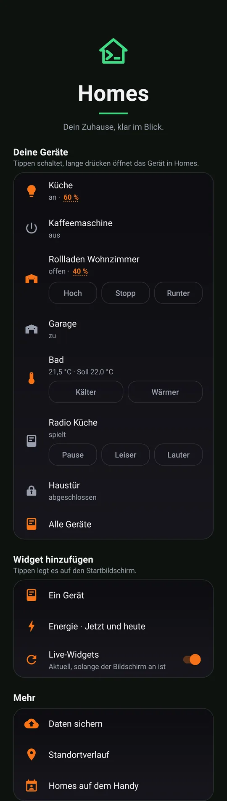
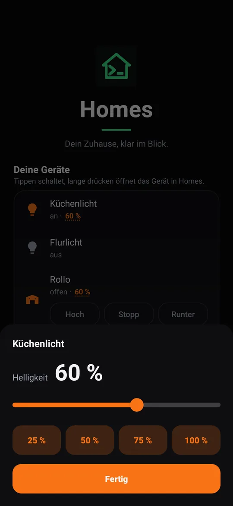
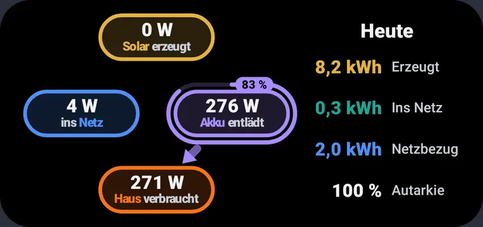
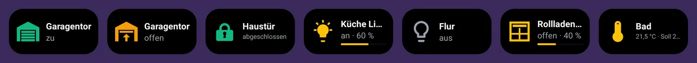
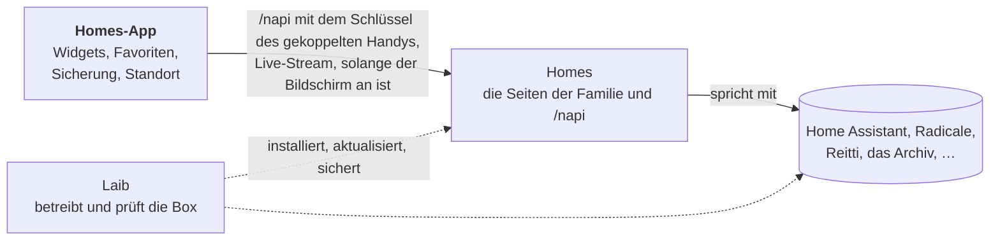

[English](README.md) · Deutsch · [Español](README.es.md) · [Français](README.fr.md)

# Homes für Android

**Dein Zuhause auf dem Startbildschirm: eine Lampe schalten, den Solarstrom
sehen, die Sicherungen deines Handys und deinen Standortverlauf zu Hause
behalten, alles mit deiner eigenen Box und ohne Google.**

Die Homes-App ist die Handy-Seite von [Homes](https://github.com/mdopp/homes),
der Familienseite auf einer [Laib](https://github.com/mdopp/laib)-Box.
Einmal koppeln, und deine Lieblingsgeräte, die Energie und die gemeinsamen
Kontakte und Kalender des Haushalts sind auf dem Handy.

  
  &nbsp;
  

  

  

Echte Bilder aus den Vorschau-Tests der App, mit Demo-Daten.

## Was du bekommst

- **Deine Geräte zuerst:** die, die du in Homes mit ☆ angeheftet hast,
  auf dem Startbildschirm der App. Ein Tipp schaltet, langes Drücken
  öffnet das Gerät in Homes, und die Helligkeit einer Lampe oder die
  Position eines Rollladens öffnet ein Fenster mit Schieberegler.
- **Widgets:** ein Gerät pro Widget (sein Zustand als Bild, ein Tipp
  schaltet es), ein Energie-Widget (Solar, Akku, Netz und Haus jetzt und
  heute) und ein Widget für eines der Werkzeuge von Homes, etwa Notizen
  oder Dokumente.
- **Live, solange du hinschaust:** Solange der Bildschirm an ist, bleiben
  die Widgets über eine einzige Live-Verbindung zu Homes aktuell. Geht
  der Bildschirm aus, hört die App auf zu lauschen. Kein Dauerabfragen.
- **Teilen → Homes:** ein Link wird zur Notiz, Fotos aus der Kamera landen
  im Dokumenten-Eingang, und eine alte Google-Maps-Zeitachse (oder eine
  GPX- oder GeoJSON-Datei) kommt in deinen Standortverlauf.
- **Daten sichern:** jeden Tag, im WLAN und beim Laden, gehen deine
  WhatsApp- und Signal-Sicherungen auf die Box. Wenn du willst, auch deine
  Kontakte, SMS und Anrufliste, verschlüsselt auf dem Handy, bevor sie es
  verlassen. Auf einem neuen Handy holt die App die Signal- und
  WhatsApp-Sicherungen zurück.
- **Der Haushalt auf dem Handy:** die gemeinsamen Kontakte, Kalender und
  Erinnerungen erscheinen als Android-Konto „Homes“, sodass Telefon-App,
  WhatsApp, Mail und Kalender-App sie sehen.
- **Standortverlauf:** wenn du ihn einschaltest, zeichnet das Handy auf, wo
  du warst, und bewahrt es in deinem eigenen Reitti auf der Box auf, bei
  niemandem sonst.
- **Ohne Google:** keine Google-Play-Dienste, kein Firebase, keine Werbung.
  Die App spricht mit deiner Box und mit sonst nichts. Nach Kontakten, SMS,
  Anrufen und Standort fragt sie erst, wenn du den Teil einschaltest, der
  sie braucht.

## Wie alles zusammenspielt

Die App spricht nur mit Homes. Homes spricht mit den Diensten des
Haushalts, und Laib betreibt sie alle auf der Box. Die genaue Naht steht in
[`docs/CONTRACT.md`](docs/CONTRACT.md) (auf Englisch).

## So bekommst du es

Du brauchst eine Laib-Box, auf der Homes läuft. Die App ist noch nicht bei
Google Play; [Obtainium](https://github.com/ImranR98/Obtainium) installiert
und aktualisiert sie direkt von GitHub:

1. Füg in Obtainium `https://github.com/mdopp/homes-android` hinzu.
2. Schalte *Include prereleases* (Vorabversionen einbeziehen) ein, wenn du
   jeden neuen Build willst, nicht nur Releases.
3. Installieren, App öffnen, deine Homes-Adresse eingeben und die Kopplung
   auf der Seite bestätigen, die sich öffnet.

## Contributing / Mitmachen

Ideen, Fehler und Wünsche sind als
[Issues](https://github.com/mdopp/homes-android/issues) willkommen. Die App
ist schlichtes Kotlin mit Gradle, getestet mit Robolectric, und jeder Pull
Request wird von der CI gebaut und geprüft.

- [`AGENTS.md`](AGENTS.md): die Regeln, Code-Gates, Bauen, Testen und
  Ausliefern, für Menschen und Coding-Agents gleichermaßen (auf Englisch).
- [`docs/CONTRACT.md`](docs/CONTRACT.md): jeder Aufruf zwischen der App und
  Homes (auf Englisch).
- [`docs/DESIGN.md`](docs/DESIGN.md): Farben, Schrift und wie Bildschirme
  und Widgets aussehen (auf Englisch).
