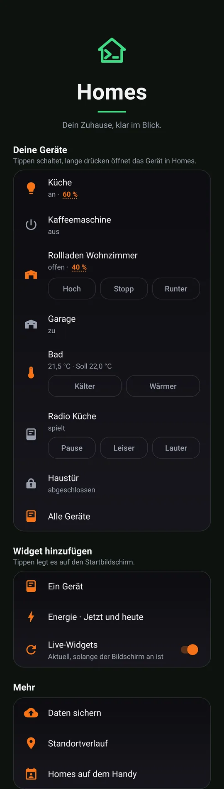
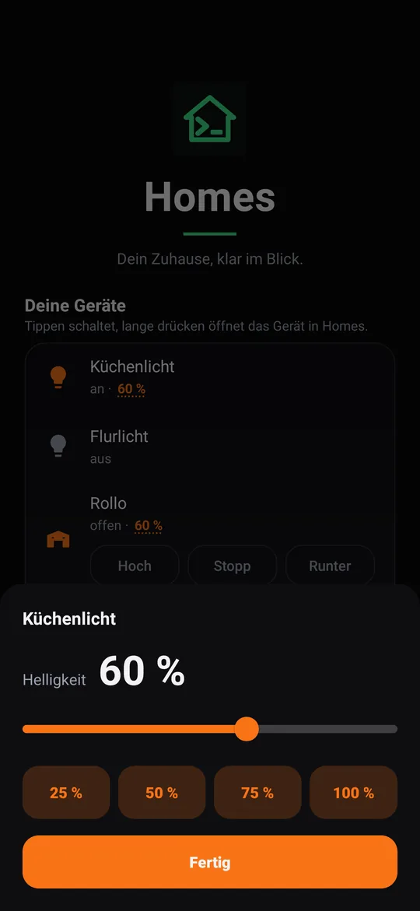
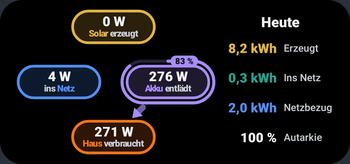
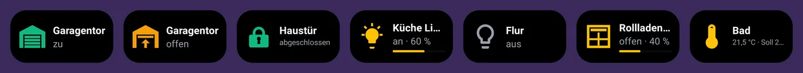
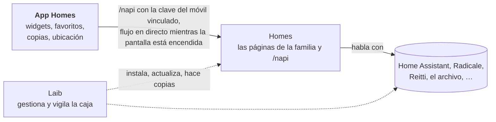

[English](README.md) · [Deutsch](README.de.md) · Español · [Français](README.fr.md)

# Homes para Android

**Tu casa en la pantalla de inicio: enciende una lámpara, mira la energía
solar, guarda en casa las copias de seguridad de tu móvil y tu historial de
ubicaciones, todo con tu propia caja y sin Google.**

La app Homes es la parte móvil de [Homes](https://github.com/mdopp/homes),
la página de la familia en una caja [Laib](https://github.com/mdopp/laib).
Vincúlala una vez y tendrás en el móvil tus dispositivos favoritos, la
energía y los contactos y el calendario compartidos del hogar.

  
  &nbsp;
  

  

  

Imágenes reales de las pruebas de vista previa de la app, con datos de demostración.

## Qué obtienes

La app está en alemán; los nombres de las pantallas aparecen aquí tal como
los ves, con una breve traducción.

- **Tus dispositivos primero:** los que fijaste con ☆ en Homes, en la
  pantalla de inicio de la app. Un toque enciende o apaga, una pulsación
  larga abre el dispositivo en Homes, y el brillo de una lámpara o la
  posición de una persiana abren un panel con un control deslizante.
- **Widgets:** un dispositivo por widget (su estado como imagen; un toque
  lo enciende o apaga), un widget de energía (solar, batería, red y casa
  ahora y hoy), y un widget para una de las herramientas de Homes, como
  las notas o los documentos.
- **En directo mientras miras:** mientras la pantalla está encendida, los
  widgets se mantienen al día a través de una única conexión en directo
  con Homes. Cuando la pantalla se apaga, la app deja de escuchar. Sin
  sondeos constantes.
- **Compartir → Homes:** un enlace se convierte en una nota, las fotos de
  la cámara van a la bandeja de documentos, y una antigua cronología de
  Google Maps (o un archivo GPX o GeoJSON) va a tu historial de
  ubicaciones.
- **Daten sichern** (copia de seguridad): cada día, con wifi y mientras se
  carga, tus copias de WhatsApp y Signal van a la caja. Si quieres,
  también tus contactos, tus SMS y tu registro de llamadas, cifrados en el
  móvil antes de salir de él. En un móvil nuevo, la app recupera las
  copias de Signal y WhatsApp.
- **El hogar en el móvil:** los contactos, calendarios y recordatorios
  compartidos aparecen como una cuenta de Android «Homes», así que el
  teléfono, WhatsApp, el correo y la app de calendario los ven.
- **Standortverlauf** (historial de ubicaciones): si lo activas, el móvil
  registra dónde has estado y lo guarda en tu propio Reitti en la caja, no
  en el de nadie más.
- **Sin Google:** sin servicios de Google Play, sin Firebase, sin
  anuncios. La app habla con tu caja y con nada más. Los permisos de
  contactos, SMS, llamadas y ubicación solo se piden cuando activas la
  parte que los necesita.

## Cómo encaja todo

La app solo habla con Homes. Homes habla con los servicios del hogar, y
Laib los ejecuta todos en la caja. La frontera exacta está en
[`docs/CONTRACT.md`](docs/CONTRACT.md) (en inglés).

## Cómo conseguirla

Necesitas una caja Laib que ejecute Homes. La app aún no está en Google
Play; [Obtainium](https://github.com/ImranR98/Obtainium) la instala y la
actualiza directamente desde GitHub:

1. En Obtainium, añade `https://github.com/mdopp/homes-android`.
2. Activa *Include prereleases* («incluir versiones preliminares») si
   quieres cada nueva compilación, no solo las versiones publicadas.
3. Instálala, abre la app, escribe la dirección de tu Homes y confirma la
   vinculación en la página que se abre.

## Contributing / Mitmachen

Las ideas, los errores y los deseos son bienvenidos como
[issues](https://github.com/mdopp/homes-android/issues). La app es Kotlin
sencillo con Gradle, probada con Robolectric, y la CI compila y revisa cada
pull request.

- [`AGENTS.md`](AGENTS.md): las reglas, los controles de código, la
  compilación, las pruebas y la publicación, para personas y agentes de
  programación por igual (en inglés).
- [`docs/CONTRACT.md`](docs/CONTRACT.md): cada llamada entre la app y Homes
  (en inglés).
- [`docs/DESIGN.md`](docs/DESIGN.md): colores, tipografía y cómo se ven las
  pantallas y los widgets (en inglés).
