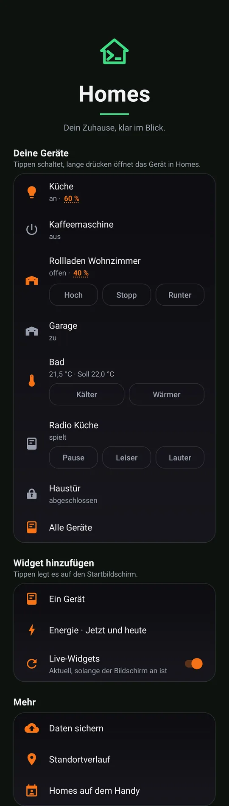
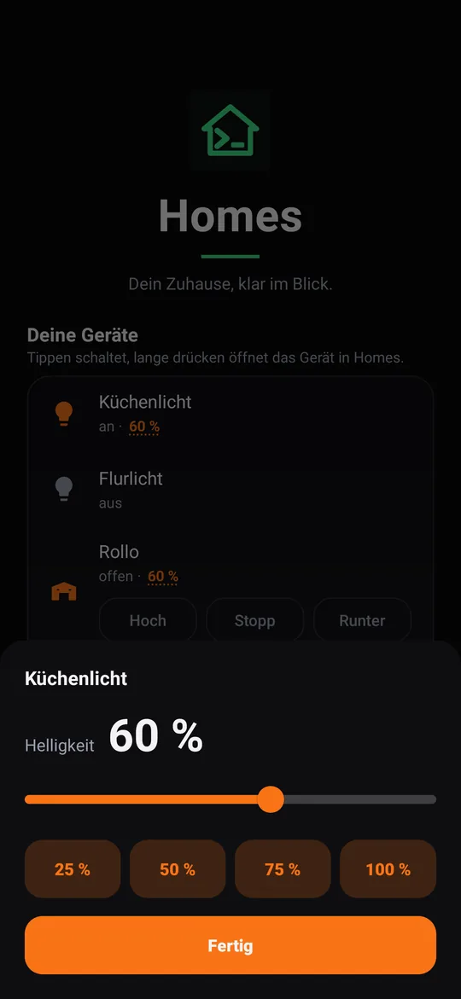
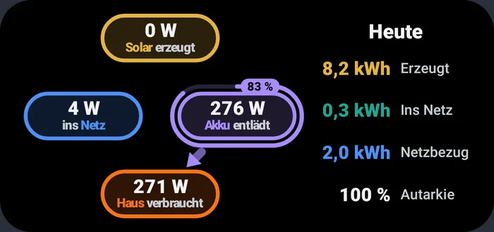
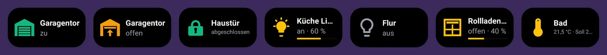
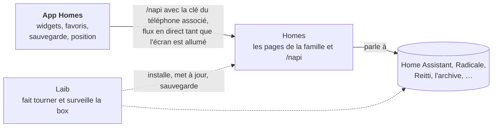

[English](README.md) · [Deutsch](README.de.md) · [Español](README.es.md) · Français

# Homes pour Android

**Votre maison sur l'écran d'accueil : allumer une lampe, suivre l'énergie
solaire, garder chez vous les sauvegardes de votre téléphone et votre
historique de position, le tout avec votre propre box et sans Google.**

L'app Homes est le côté téléphone de [Homes](https://github.com/mdopp/homes),
la page de la famille sur une box [Laib](https://github.com/mdopp/laib).
Associez-la une fois, et vos appareils favoris, l'énergie, ainsi que les
contacts et l'agenda partagés du foyer sont sur le téléphone.

  
  &nbsp;
  

  

  

De vrais rendus issus des tests d'aperçu de l'app, sur des données de démonstration.

## Ce que vous obtenez

L'app est en allemand ; les noms des écrans apparaissent ici tels que vous
les voyez, avec une courte traduction.

- **Vos appareils d'abord :** ceux que vous avez épinglés avec ☆ dans
  Homes, sur l'écran d'accueil de l'app. Un appui allume ou éteint, un
  appui long ouvre l'appareil dans Homes, et la luminosité d'une lampe ou
  la position d'un volet ouvre un panneau avec un curseur.
- **Widgets :** un appareil par widget (son état en image, un appui
  l'allume ou l'éteint), un widget énergie (solaire, batterie, réseau et
  maison en ce moment et sur la journée), et un widget pour l'un des
  outils de Homes, comme les notes ou les documents.
- **En direct quand vous regardez :** tant que l'écran est allumé, les
  widgets restent à jour grâce à une seule connexion en direct avec
  Homes. Quand l'écran s'éteint, l'app cesse d'écouter. Pas
  d'interrogation en boucle.
- **Partager → Homes :** un lien devient une note, les photos de
  l'appareil photo vont dans la boîte de réception des documents, et un
  ancien historique Google Maps (ou un fichier GPX ou GeoJSON) rejoint
  votre historique de position.
- **Daten sichern** (sauvegarder les données) : chaque jour, en Wi-Fi et
  pendant la charge, vos sauvegardes WhatsApp et Signal partent sur la
  box. Si vous le souhaitez, aussi vos contacts, vos SMS et votre journal
  d'appels, chiffrés sur le téléphone avant de le quitter. Sur un nouveau
  téléphone, l'app récupère les sauvegardes Signal et WhatsApp.
- **Le foyer sur le téléphone :** les contacts, agendas et rappels
  partagés apparaissent comme un compte Android « Homes », si bien que le
  téléphone, WhatsApp, la messagerie et l'app d'agenda les voient.
- **Standortverlauf** (historique de position) : si vous l'activez, le
  téléphone enregistre où vous êtes allé et le garde dans votre propre
  Reitti sur la box, chez personne d'autre.
- **Sans Google :** pas de services Google Play, pas de Firebase, pas de
  publicité. L'app parle à votre box et à rien d'autre. Les accès aux
  contacts, SMS, appels et à la position ne sont demandés que lorsque
  vous activez la partie qui en a besoin.

## Comment tout s'articule

L'app ne parle qu'à Homes. Homes parle aux services du foyer, et Laib les
fait tous tourner sur la box. La jonction exacte est décrite dans
[`docs/CONTRACT.md`](docs/CONTRACT.md) (en anglais).

## L'obtenir

Il vous faut une box Laib qui fait tourner Homes. L'app n'est pas encore
sur Google Play ; [Obtainium](https://github.com/ImranR98/Obtainium)
l'installe et la met à jour directement depuis GitHub :

1. Dans Obtainium, ajoutez `https://github.com/mdopp/homes-android`.
2. Activez *Include prereleases* (« inclure les préversions ») si vous
   voulez chaque nouvelle build, pas seulement les versions publiées.
3. Installez, ouvrez l'app, saisissez l'adresse de votre Homes et
   confirmez l'association sur la page qui s'ouvre.

## Contributing / Mitmachen

Idées, bugs et envies sont les bienvenus sous forme
d'[issues](https://github.com/mdopp/homes-android/issues). L'app est du
Kotlin simple avec Gradle, testée avec Robolectric, et chaque pull request
est construite et vérifiée par la CI.

- [`AGENTS.md`](AGENTS.md) : les règles, les contrôles de code, la
  construction, les tests et la publication, pour les humains comme pour
  les agents de code (en anglais).
- [`docs/CONTRACT.md`](docs/CONTRACT.md) : chaque appel entre l'app et
  Homes (en anglais).
- [`docs/DESIGN.md`](docs/DESIGN.md) : couleurs, typographie et apparence
  des écrans et des widgets (en anglais).
