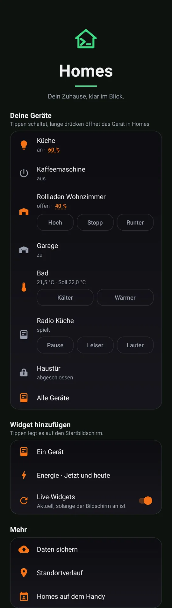
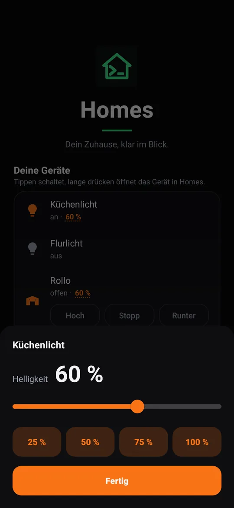
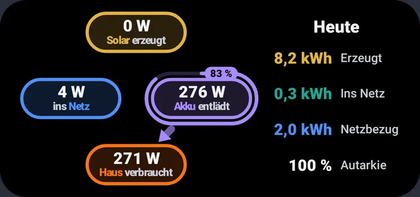
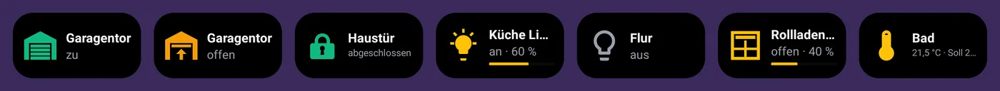
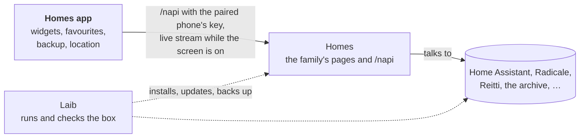

# Homes for Android

**Your home on your home screen: switch a lamp, watch the solar power,
keep your phone's backups and your location history at home, all with your
own box and without Google.**

The Homes app is the phone side of [Homes](https://github.com/mdopp/homes),
the family's page on a [Laib](https://github.com/mdopp/laib) box. Pair it
once, and your favourite devices, the energy and the household's shared
contacts and calendar are on the phone.

  
  &nbsp;
  

  

  

Real renders from the app's preview tests, on demo data.

## What you get

- **Your devices first:** the ones you pinned with ☆ in Homes, on the
  app's start screen. A tap switches, a long press opens the device in
  Homes, and a lamp's brightness or a shutter's position opens a sheet
  with a slider.
- **Widgets:** one device per widget (its state as a picture, a tap
  switches it), an energy widget (solar, battery, grid and house now, and
  today), and a widget for one of Homes' tools, such as notes or
  documents.
- **Live while you look:** while the screen is on, the widgets stay
  current through one live connection to Homes. When the screen goes off,
  the app stops listening. No polling.
- **Share → Homes:** a link becomes a note, photos from the camera go into
  the document inbox, and an old Google Maps timeline (or a GPX or GeoJSON
  file) goes into your location history.
- **Daten sichern:** every day, on Wi-Fi while charging, your WhatsApp and
  Signal backups go to the box. If you want, also your contacts, and your
  SMS and call log, encrypted on the phone before they leave it. On a new
  phone the app brings the Signal and WhatsApp backups back.
- **The household on the phone:** the shared contacts, calendars and
  reminders appear as an Android account „Homes“, so the dialer, WhatsApp,
  mail and the calendar app see them.
- **Standortverlauf:** if you switch it on, the phone records where you
  were and keeps it in your own Reitti on the box, nobody else's.
- **Without Google:** no Google Play services, no Firebase, no ads. The
  app talks to your box and nothing else. Contacts, SMS, calls and
  location are asked for only when you switch on the part that needs
  them.

## How it fits together

The app talks only to Homes. Homes talks to the household's services, and
Laib runs all of them on the box. The exact seam is
[`docs/CONTRACT.md`](docs/CONTRACT.md).

## Get it

You need a Laib box that runs Homes. The app is not on Google Play yet;
[Obtainium](https://github.com/ImranR98/Obtainium) installs and updates it
straight from GitHub:

1. In Obtainium, add `https://github.com/mdopp/homes-android`.
2. Turn on *Include prereleases* if you want every new build, not only
   releases.
3. Install, open the app, enter your Homes address and confirm the
   pairing on the page that opens.

**Coming from the Haus app?** Homes is a new app beside it (its own package,
`cloud.dopp.homes`): add it in Obtainium as above, pair it, place the
widgets again, then remove Haus and its Obtainium entry.

## Contributing / Mitmachen

Ideas, bugs and wishes are welcome as
[issues](https://github.com/mdopp/homes-android/issues). The app is plain
Kotlin with Gradle, tested with Robolectric, and every pull request is
built and checked by CI.

- [`AGENTS.md`](AGENTS.md): the rules, code gates, build, test and
  release, for people and coding agents alike.
- [`docs/CONTRACT.md`](docs/CONTRACT.md): every call between the app and
  Homes.
- [`docs/DESIGN.md`](docs/DESIGN.md): colours, type and how screens and
  widgets look.
